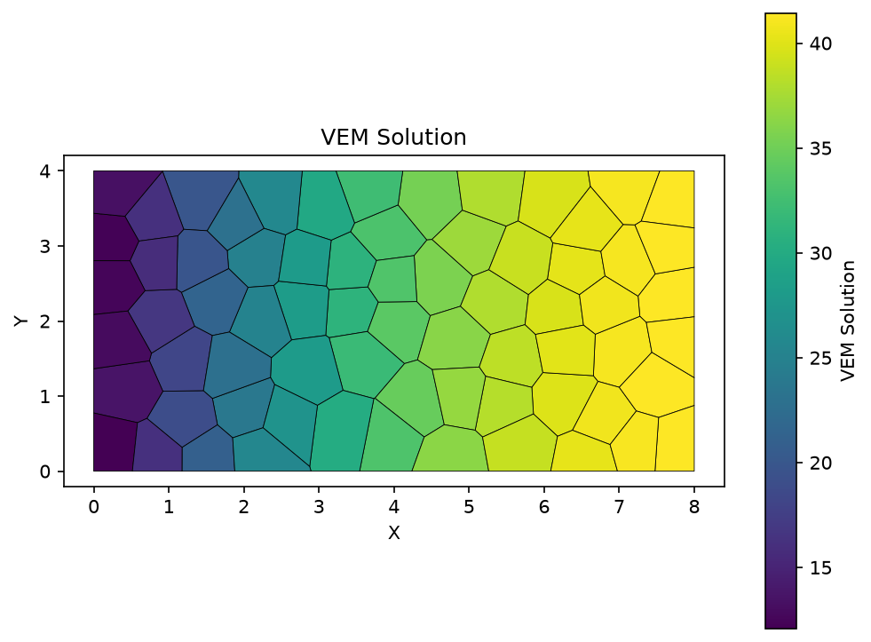
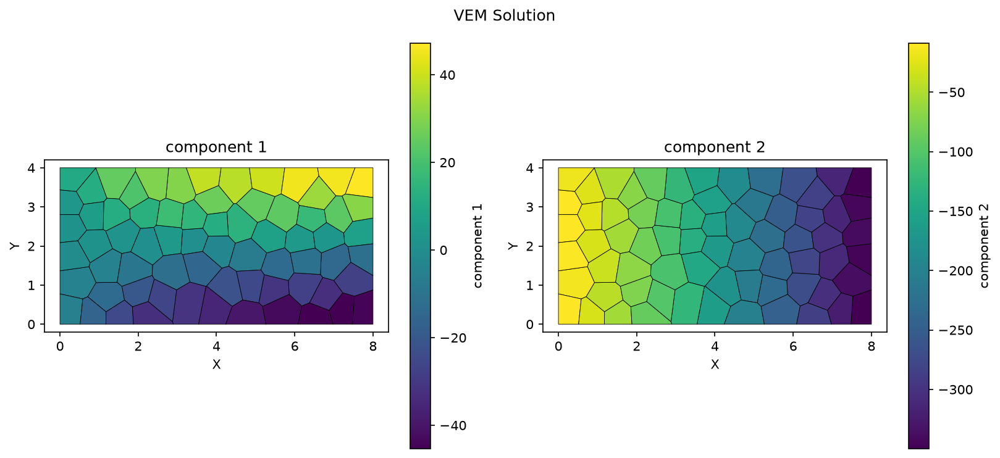
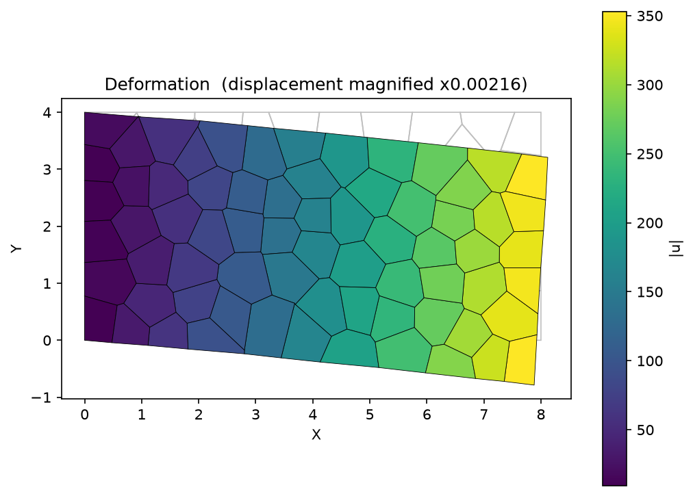
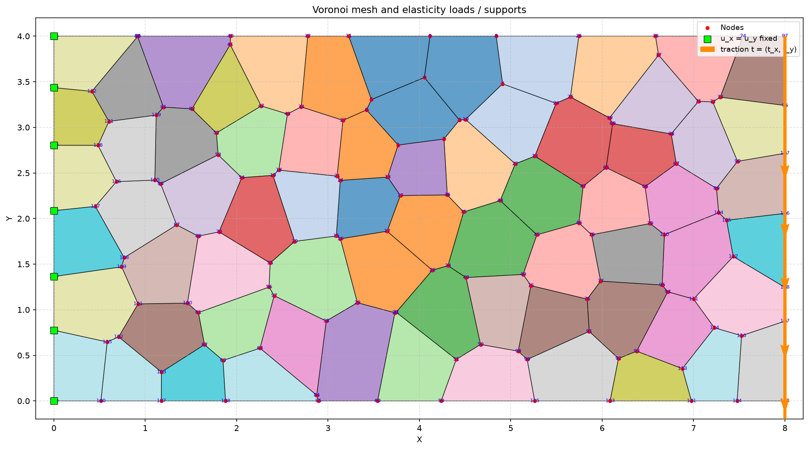

# VEM — Virtual Element Method solvers in Python

Two independent VEM solvers on unstructured polygonal (Voronoi) meshes: a scalar
Poisson solver and a 2-D linear elasticity solver, both written from scratch in
plain Python + NumPy.

The code implements the conforming $H^1$ virtual element space without ever
writing down the basis functions inside an element. Only the degrees of freedom
on the element boundary are used: a **Ritz projection** is built from the edge
data, and the element stiffness matrix is assembled as a *consistency* part plus
a *stability* part. The mesh is polygonal (Voronoi), so no triangle or quad
re-meshing is required.

- `Poisson/` — scalar Poisson equation, 4–8 vertices per element
- `LinearElasticity/` — 2-D linear elasticity, 2 DOF per node ($u_x$, $u_y$)

---

## Repository layout

```
VEM_Solver/
├── README.md
├── LICENSE
├── requirements.txt
├── .gitignore
├── Poisson/                    # scalar Poisson solver
│   ├── main.py                 # pipeline: read mesh -> assemble -> apply BC -> solve -> plot
│   ├── mesh_input.py           # polygonal mesh reader
│   ├── local_K.py              # element stiffness matrix (Ritz projection + consistency + stability)
│   ├── global_K.py             # global stiffness assembly
│   ├── construct_F.py          # load vector (integral of f over each element)
│   ├── bc.py                   # Dirichlet / Neumann boundary conditions
│   ├── solve.py                # linear solver
│   ├── post.py                 # post-processing (gradient recovery, TODO)
│   ├── visual.py               # visualisation
│   ├── voronoi_mesh.txt        # input mesh
│   ├── boundary_condition.txt  # input boundary conditions
│   └── solution_plot.png       # result (reproducible by running main.py)
└── LinearElasticity/           # 2-D linear elasticity solver
    ├── main.py
    ├── mesh_input.py
    ├── local_K.py              # elasticity VEM element matrix (with mean-rotation constraint)
    ├── global_K.py             # global matrix, u_x and u_y blocks
    ├── construct_F.py          # nodal body force + Neumann tractions
    ├── bc.py                   # per-component Dirichlet, rigid-body check, reactions
    ├── solve.py
    ├── post.py                 # empty file (TODO)
    ├── visual.py               # solution field + deformed mesh + BC sketch
    ├── voronoi_mesh.txt
    ├── boundary_condition.txt
    ├── boundary_conditions.png
    ├── solution_plot.png
    └── deformation_plot.png
```

Both solvers use **flat modules**: `main.py` does `import mesh_input` from the
same directory, so the scripts must be run from inside their own folder.

---

## Requirements

- Python ≥ 3.9
- `numpy`, `matplotlib`

```bash
python3 -m venv .venv
source .venv/bin/activate          # Windows: .venv\Scripts\activate
pip install -r requirements.txt
```

All scripts were verified on Python 3.11.17 with numpy 2.4.6 and
matplotlib 3.11.2, and the PNG files they produce are byte-identical to the
figures committed in this repository.

---

## Quick start

```bash
git clone https://github.com/DongxiaoLyu/VEM_Solver.git
cd VEM_Solver

# Poisson equation
cd Poisson
python main.py                     # writes solution_plot.png

# 2-D linear elasticity
cd LinearElasticity
python main.py                     # writes solution_plot.png, deformation_plot.png
```

Each module also has a small self-check entry point that prints intermediate
quantities (useful for debugging):

```bash
cd Poisson          && python mesh_input.py      # print the nodes and elements read
cd Poisson          && python local_K.py         # print Ke of a unit square
cd LinearElasticity && python bc.py              # print boundary condition statistics
cd LinearElasticity && python local_K.py         # print Ke
```

---

## Results

### Poisson equation

Unit source term $f=1$, $u=10$ on the left edge, normal flux $q=10$ on the right
edge: the solution rises monotonically from left to right, $u \in [10.0,\ 41.5]$.



### 2-D linear elasticity

Left edge clamped ($u_x=u_y=0$), downward uniform traction $t=(0,-10)$ on the
right edge. The material parameters ($E=1$, $\nu=0.3$, plane stress by default)
are set inside `local_K.py`, so the **absolute displacement is only meaningful in
relative terms**; what matters is the deformation pattern and the magnitude
ratios.





Boundary conditions (nodes, fixed components, traction direction):



---

## License

MIT License, see [LICENSE](LICENSE).
